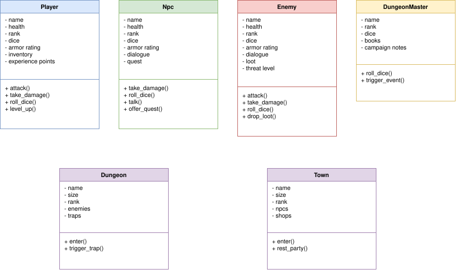
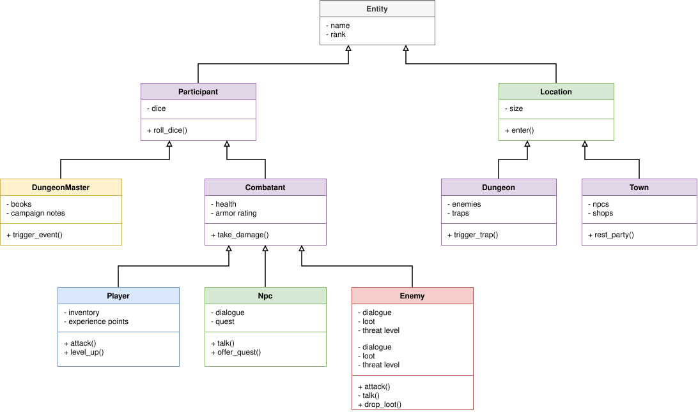

# Inheritance

## Vorige keer

Vorige keer hebben we classes behandeld. Een class bundelt data en de functies die daarbij horen. Met `private` bepaal je zelf wie er bij de data mag en met de constructor begint een object altijd in een geldige toestand. Laten we dat even ophalen met een kroeg die maximaal 100 gasten binnen mag laten.

```PHP
class PatronManager
{
    public int $maxPatrons = 100;
    public int $counter = 0;

    public function addPatron(int $amount = 1)
    {
        if ($this->counter + $amount > $this->maxPatrons) {
            throw new \Exception("Can not allow patrons for safety reasons.");
        }
        $this->counter += $amount;
    }
}
```

De controle in `addPatron()` zorgt ervoor dat er nooit meer dan 100 gasten binnen komen. Dit werkt, tot iemand dit schrijft:

```PHP
$patronManager->counter = 50;
$patronManager->maxPatrons = 200;
$patronManager->addPatron(100);
```

Beide properties zijn `public`, dus iedereen kan de teller terugzetten of de capaciteit verhogen. De controle wordt gewoon omzeild. Dit hebben we in `barchaos` uitgeprobeerd: na deze regels staan er 150 gasten in een kroeg voor 100.

Laten we het oplossen zoals we in de vorige les hebben geleerd:

```PHP
class PatronManager
{
    private readonly int $maxPatrons;
    private int $counter = 0;

    public function __construct(int $maxPatrons = 100)
    {
        $this->maxPatrons = $maxPatrons;
    }

    public function addPatron(int $amount = 1): void
    {
        if ($amount < 1) {
            throw new \Exception("You have to let in at least one patron.");
        }

        if ($this->counter + $amount > $this->maxPatrons) {
            throw new \Exception("Can not allow patrons for safety reasons.");
        }

        $this->counter = $this->counter + $amount;
    }

    public function getPatronCount(): int
    {
        return $this->counter;
    }
}
```

Let op de punten:
- `counter` is `private`. Alleen `addPatron()` verandert hem nog.
- `maxPatrons` is `private readonly`. De capaciteit wordt bij het openen bepaald en kan daarna niet meer veranderen.
- De methods krijgen types. Zo weten we wat er in en uit gaat.
- Ook `private` is geen garantie. Zonder de controle op `$amount < 1` kon je met `addPatron(-10)` de teller omlaag krijgen. De regels zelf moeten dus ook kloppen.

Probeer je nu `$patronManager->counter = 50;`, dan krijg je `Cannot access private property PatronManager::$counter`. Zie `example/herhaling/barfixed/` voor de volledige versie. De vraag voor vandaag is: wat doen we als we meerdere classes hebben die veel op elkaar lijken?

## Het probleem: classes die veel op elkaar lijken

We gaan een rollenspel bouwen, zoals Dungeons & Dragons. In het spel komen drie soorten personages voor:

- `Player`: de speler. Heeft een naam, health, armor en ervaringspunten.
- `Npc`: een personage dat niet door een speler wordt bestuurd, zoals de barkeeper. Heeft een naam, health, armor en een dialoog.
- `Enemy`: een vijand. Heeft een naam, health, armor en loot.

Zonder iets nieuws schrijven we voor iedere soort een eigen class:

```PHP
class Player
{
    private string $name;
    private int $health;
    private int $armorRating;
    private int $experiencePoints = 0;

    public function __construct(string $name, int $health, int $armorRating)
    {
        $this->name = $name;
        $this->health = $health;
        $this->armorRating = $armorRating;
    }

    public function takeDamage(int $damage): void
    {
        $this->health = $this->health - max(0, $damage - $this->armorRating);
    }

    public function levelUp(): void
    {
        $this->experiencePoints = $this->experiencePoints + 100;
    }
}
```

`Npc` ziet er bijna hetzelfde uit, met `dialogue` in plaats van `experiencePoints` en een method `talk()`. En `Enemy` heeft `loot` en `dropLoot()`.

In het diagram zie je wat hier gebeurt:



Kijk naar de drie classes en zie hoeveel er dubbel staat: `name`, `health`, `armorRating`, `takeDamage()`, de getters en het begin van de constructor staan overal. Dit is hetzelfde probleem als in de les over functies: kopiëren. Moet `takeDamage()` anders werken, dan pas je hem op drie plekken aan en vergeet je er vast een. Zie `without_inheritance.php`.

## Inheritance

Bij **inheritance** (overerving) verplaats je wat de classes gemeen hebben naar één plek: een **parent** class. De andere classes, de **child** classes, erven daarvan. Ze krijgen alle properties en methods van de parent erbij, en voegen alleen toe wat ze zelf extra hebben.

In Python ken je dit al:

```Python
class Player(Combatant):
    ...
```

In PHP gebruik je het woord `extends`:

```PHP
class Combatant
{
    protected string $name;
    protected int $health;
    protected int $armorRating;

    public function __construct(string $name, int $health, int $armorRating)
    {
        $this->name = $name;
        $this->health = $health;
        $this->armorRating = $armorRating;
    }

    public function takeDamage(int $damage): void
    {
        $this->health = $this->health - max(0, $damage - $this->armorRating);
    }

    public function getName(): string
    {
        return $this->name;
    }

    public function getHealth(): int
    {
        return $this->health;
    }
}

class Player extends Combatant
{
    private int $experiencePoints = 0;

    public function levelUp(): void
    {
        $this->experiencePoints = $this->experiencePoints + 100;
    }
}
```

Let op de punten:
- `Player extends Combatant` betekent: een `Player` **is een** `Combatant`.
- `Player` bevat zelf alleen `experiencePoints` en `levelUp()`. De rest komt van `Combatant`, ook de constructor.
- Een object van `Player` kan dus alles wat `Combatant` kan:

```PHP
$player = new Player("Aragorn", 100, 5);
$player->takeDamage(20);
$player->levelUp();

echo $player->getName() . " heeft nog " . $player->getHealth() . " health\n";
```

De uitvoer is `Aragorn heeft nog 85 health`: 20 schade min 5 armor is 15. We hebben `takeDamage()` en `getName()` niet in `Player` geschreven, maar ze zijn er wel. Zie `extends_basics.php`.

In Python kun je bij `class A(B, C)` van meerdere classes tegelijk erven. In PHP kan dat niet: een class heeft maximaal één parent. Wel kan die parent zelf weer een parent hebben, daar komen we zo op terug.

### protected

Waarom is `name` hier `protected` en niet `private`? Dat komt door de access modifiers uit de vorige les. Er is er nu eentje bij:

| Modifier | Wie kan erbij |
|---|---|
| `public` | Iedereen |
| `protected` | De class zelf en alle classes die ervan erven |
| `private` | Alleen de class zelf |

Een `private` property van de parent is voor de child onzichtbaar. Zou `health` in `Combatant` `private` zijn, dan geeft `$this->health` in een method van `Player` een `Warning: Undefined property`. `protected` laat de child er wel bij, maar houdt de buitenwereld nog steeds buiten: `echo $player->health;` geeft nog steeds een Error. De vuistregel van vorige les blijft staan: begin met `private` en maak het pas `protected` als een child class er echt bij moet.

### De constructor van de parent

Een `Npc` heeft een extra argument nodig: de dialoog. Daarom krijgt `Npc` een eigen constructor. Maar let op: een eigen constructor **vervangt** die van de parent. De parent constructor wordt dan niet meer vanzelf aangeroepen. Daarom roepen we hem zelf aan met `parent::`:

```PHP
class Npc extends Combatant
{
    private string $dialogue;

    public function __construct(string $name, int $health, int $armorRating, string $dialogue)
    {
        parent::__construct($name, $health, $armorRating);

        $this->dialogue = $dialogue;
    }

    public function talk(): string
    {
        return $this->dialogue;
    }
}
```

`parent::__construct(...)` voert de constructor van `Combatant` uit, zodat `name`, `health` en `armorRating` gezet worden. Daarna zetten we alleen wat `Npc` zelf erbij heeft. In Python is dit `super().__init__(...)`.

Vergeet je `parent::__construct()`, dan worden `name`, `health` en `armorRating` nooit gezet. Een `getName()` geeft dan `Typed property Combatant::$name must not be accessed before initialization`. Zie `parent_constructor.php`.

### Een method overschrijven

Een child kan een method van de parent **overschrijven** (override). Je schrijft dan in de child een method met dezelfde naam en dezelfde parameters. Voor een object van de child wordt dan jouw versie gebruikt.

```PHP
class Combatant
{
    // ...

    public function describe(): string
    {
        return $this->name . " (" . $this->health . " health)";
    }
}

class Npc extends Combatant
{
    // ...

    public function describe(): string
    {
        return $this->name . " zegt: \"" . $this->dialogue . "\"";
    }
}
```

Een `Combatant` beschrijft zichzelf met naam en health. Een `Npc` heeft een eigen verhaal en vervangt de method helemaal.

Soms wil je de method van de parent niet vervangen maar uitbreiden. Dan gebruik je opnieuw `parent::`:

```PHP
class Enemy extends Combatant
{
    // ...

    public function describe(): string
    {
        return parent::describe() . " en heeft " . $this->loot . " bij zich";
    }

    public function takeDamage(int $damage): void
    {
        parent::takeDamage($damage);

        if ($this->health <= 0) {
            echo $this->name . " is verslagen en laat " . $this->loot . " vallen\n";
        }
    }
}
```

Bij `describe()` geven we het resultaat van de parent terug met iets erachter. Bij `takeDamage()` laten we het rekenwerk aan de parent en voegen we er een controle aan toe. We kopiëren dus niets, en verandert de berekening in `Combatant`, dan verandert hij ook voor `Enemy`. Zie `override.php`.

### Een hele boom

Een parent kan zelf ook weer een parent hebben. Zo krijg je een boom van classes. Dit is het diagram van ons rollenspel:



Lees het diagram van onder naar boven:

- `Player`, `Npc` en `Enemy` erven van `Combatant`.
- `Combatant` en `DungeonMaster` erven van `Participant`, een deelnemer die met dobbelstenen gooit.
- `Participant` en `Location` erven van `Entity`. Alles in het spel heeft een naam en een rank.
- `Town` en `Dungeon` erven van `Location`.

Een `Player` krijgt dus alles van `Combatant`, `Participant` en `Entity` erbij. Dat zijn `name` en `rank` van `Entity`, `dice` en `rollDice()` van `Participant` en `health` en `takeDamage()` van `Combatant`. Een `Town` is geen `Participant`: die heeft geen dobbelstenen en geen health, maar wel een `size` en `enter()`. Vergelijk dit diagram met het vorige: elke property en method staat nu maar één keer.

```PHP
$player = new Player("Aragorn", 1, 20, 100, 5);

echo $player->getName();     // uit Entity
$player->rollDice();         // uit Participant
$player->takeDamage(15);     // uit Combatant
$player->levelUp();          // uit Player zelf
```

Elke class in de keten roept `parent::__construct()` aan, zodat alle properties tot aan `Entity` gezet worden. Zie `hierarchy.php` voor de volledige boom.

Let op: een boom met veel lagen is lastig aan te passen. Verander je iets in `Entity`, dan merkt elke class in het spel dat. Daarom maken we de boom niet dieper dan nodig is.

## Inheritance of compositie

Inheritance is handig, maar je kunt het ook verkeerd gebruiken. Stel dat een `Player` een rugzak (`Inventory`) heeft om spullen in te bewaren. Het is verleidelijk om te schrijven:

```PHP
class Player extends Inventory
```

Dan kan een `Player` meteen `add()` en `list()` gebruiken. Maar klopt het? Is een speler een rugzak? Nee. Een speler **heeft een** rugzak. Dat is de test om te onthouden:

- **is een** past bij inheritance: een `Player` is een `Combatant`.
- **heeft een** past bij **compositie**: een `Player` heeft een `Inventory`.

Bij compositie bewaar je een ander object in een property, en laat je dat object het werk doen:

```PHP
class Player extends Combatant
{
    private Inventory $inventory;

    public function __construct(string $name, int $health, Inventory $inventory)
    {
        parent::__construct($name, $health);
        $this->inventory = $inventory;
    }

    public function pickUp(string $item): void
    {
        $this->inventory->add($item);
    }
}

$player = new Player("Aragorn", 100, new Inventory(2));
$player->pickUp("Zwaard");
```

`Player` heeft zelf geen `add()` of `list()`. Hij stuurt het werk door naar zijn `Inventory`. Het `Inventory` object geven we mee aan de constructor, net als we bij Hangman de `RandomWordGenerator` meegaven (dependency injection).

Het diagram laat nog twee voorbeelden zien: een `Dungeon` heeft `enemies` en een `Town` heeft `npcs` en `shops`. Dat zijn geen `Enemy` of `Npc`, het zijn plekken die een lijst van die objecten bevatten.

Vergelijk de twee:

| | Inheritance | Compositie |
|---|---|---|
| Relatie | `Player` **is een** `Combatant` | `Player` **heeft een** `Inventory` |
| Hoe | `extends` | Een object in een property |
| Je krijgt | Alle `public` en `protected` properties en methods van de parent | Alleen wat je zelf doorstuurt |
| Koppeling | Sterk: een wijziging in de parent raakt alle children | Losser: je kunt het object vervangen |

Twijfel je? Kies dan compositie. Inheritance gebruik je als de relatie echt "is een" is en je het gedrag van de parent ook echt wilt overnemen. Zie `composition.php`.

## Abstracte classes

Kijk nog eens naar `Combatant`. Heeft het zin om een los `new Combatant(...)` te maken? Eigenlijk niet: in ons spel is iedereen een `Player`, `Npc` of `Enemy`. `Combatant` bestaat alleen om de gemeenschappelijke code te bewaren.

Met `abstract` leggen we dat vast. Een **abstracte class** kun je niet zelf aanmaken, je kunt er alleen van erven:

```PHP
abstract class Combatant
{
    // ... properties, constructor, takeDamage() en getters zoals eerst

    abstract public function attack(): int;
}
```

Er is nog iets nieuws: een **abstracte method**. Dit is een method zonder body, alleen de naam, de parameters en het return type, afgesloten met een `;`. Hiermee zeg je: "elke Combatant kan aanvallen, maar hoe dat gaat bepaalt de child zelf". Elke child moet de method dan schrijven:

```PHP
class Player extends Combatant
{
    private int $experiencePoints = 100;

    public function attack(): int
    {
        return 10 + intdiv($this->experiencePoints, 10);
    }
}

class Enemy extends Combatant
{
    private int $threatLevel;

    // ...

    public function attack(): int
    {
        return $this->threatLevel * 4;
    }
}
```

Een speler wordt sterker met ervaring, een vijand met zijn dreigingsniveau. Dit is ook wat de diagrammen laten zien: `Player` en `Enemy` hebben allebei een `attack()`, maar ze doen iets anders.

PHP controleert dit voor je:
- `new Combatant(...)` geeft `Cannot instantiate abstract class Combatant`.
- Een class die van `Combatant` erft maar `attack()` niet schrijft, geeft een Fatal error.

Het verschil met een gewone parent: bij een gewone method die je overschrijft mag de child kiezen. Bij een abstracte method **moet** de child hem schrijven. Zo weet je zeker dat elke `Combatant` die je tegenkomt een `attack()` heeft.

Een abstracte class mag ook gewone methods hebben. `takeDamage()` heeft gewoon een body en werkt voor iedereen hetzelfde. Zie `abstract_classes.php`.

Waarom dit zo handig is, zie je in de volgende les bij polymorfisme.

## Samengevat

| Begrip | Vraag die je stelt | Let op |
|---|---|---|
| `extends` | Is dit een specifiekere soort van de parent? | Maximaal één parent per class |
| `protected` | Moet de child er bij kunnen, maar de buitenwereld niet? | Begin met `private` |
| `parent::__construct()` | Heeft de child een eigen constructor? | Vergeet je hem, dan blijven properties leeg |
| Override | Moet de child iets anders doen dan de parent? | Gebruik `parent::method()` om uit te breiden |
| Compositie | Heeft dit object een ander object, in plaats van dat het er een is? | Twijfel je, kies dan compositie |
| `abstract` | Moet elke child dit zelf invullen? | Een abstracte class kan niet met `new` aangemaakt worden |

## Voorbeeldbestanden

De voorbeelden bouwen stap voor stap op en gebruiken het rollenspel uit de diagrammen. Run ze met `php bestandsnaam.php` vanuit de map `example/inheritance`.

1. [barchaos](./example/herhaling/barchaos/index.php) en [barfixed](./example/herhaling/barfixed/index.php) (map `example/herhaling`) laten de kroeg zonder en met `private`, `readonly` en een constructor zien.
2. [without_inheritance.php](./example/inheritance/without_inheritance.php) laat `Player`, `Npc` en `Enemy` zien met alles drie keer.
3. [extends_basics.php](./example/inheritance/extends_basics.php) verplaatst de gedeelde code naar `Combatant` met `extends` en `protected`.
4. [parent_constructor.php](./example/inheritance/parent_constructor.php) geeft `Npc` en `Enemy` een eigen constructor met `parent::__construct()`.
5. [override.php](./example/inheritance/override.php) overschrijft `describe()` en `takeDamage()`, met en zonder `parent::`.
6. [hierarchy.php](./example/inheritance/hierarchy.php) bouwt de hele boom uit het diagram: `Entity`, `Participant`, `Combatant`, `Location` en alles eronder.
7. [composition.php](./example/inheritance/composition.php) geeft een `Player` een `Inventory` en een `Dungeon` een lijst van `Enemy` objecten.
8. [abstract_classes.php](./example/inheritance/abstract_classes.php) maakt `Combatant` abstract met een abstracte `attack()`.

De diagrammen staan als draw.io bestanden in de map `diagrams`: [zonderinheritance.drawio](./diagrams/zonderinheritance.drawio) en [metinheritance.drawio](./diagrams/metinheritance.drawio).

## Labs

Wil je zien wat er in het geheugen gebeurt met een object dat van een parent erft? In de interactieve labs volg je een programma regel voor regel. Open [index.html](./example/inheritance/lab/index.html) in je browser, je hoeft niets te installeren. Werkt de opmaak niet, start dan `php -S localhost:8090` in de map `example/inheritance/lab`.

1. [objects.html](./example/inheritance/lab/objects.html) is Lab 1. Een step debugger met vier scenario's: een `Player` die van `Combatant` erft, de constructor van de parent met `parent::__construct()`, een method die wordt overschreven en een boom van vier classes. Bij elke property in het object staat uit welke class hij komt.
2. [predict_output.html](./example/inheritance/lab/predict_output.html) is Lab 2. Zes scenario's waarbij je eerst voorspelt wat er gebeurt, zoals een method die vervangen of uitgebreid is, een `protected` property van buiten lezen en een constructor die die van de parent vervangt.
3. [bughunt.html](./example/inheritance/lab/bughunt.html) is Lab 3. Drie scripts die iets anders doen dan bedoeld: een vergeten `parent::__construct()`, een `private` property in de parent en een override zonder `parent::takeDamage()`.

Met `php verify_lab1.php` tot en met `php verify_lab3.php` (in de map `example/inheritance`) controleer je dat de antwoorden in de labs kloppen met wat PHP echt doet.

## Opgaven

De opgaven staan in [inheritance_opgaven_1.md](./inheritance_opgaven_1.md).
